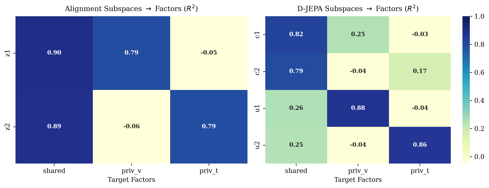
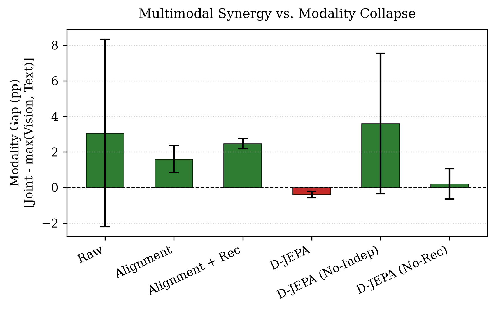
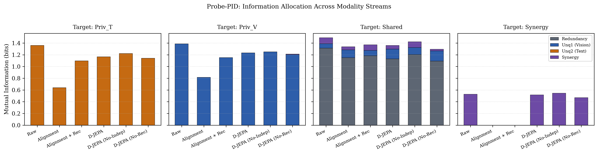
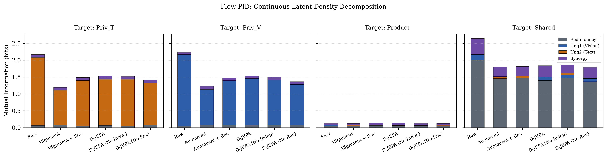

# PID-JEPA

[](LICENSE)
[](pyproject.toml)

Partial-information decomposition of multimodal joint-embedding pretraining.
The benchmark compares **D-JEPA** against **alignment-only** representations on
a synthetic ground-truth dataset and on real CLEVR.

The code is deliberately small: one module per concern, a single CLI, and a
`report.json` schema that can regenerate most figures without retraining.

## What it does

1. **Data** — a synthetic multimodal bundle with known shared,
   vision-private, text-private, and synergistic factors, or real CLEVR from
   `HuggingFaceM4/the_cauldron` encoded with frozen DINOv2 and BERT towers.
2. **Arms** — `alignment`, `alignment_rec`, `djepa`, `djepa_noindep`,
   `djepa_norec`, plus a `raw` frozen-backbone baseline. D-JEPA splits each
   stream's embedding into a shared code `c` and a private fibre `u`.
3. **Pretraining** — invariance, cross-modal alignment, SIGReg
   (sliced Epps–Pulley) anti-collapse, and optional reconstruction and
   independence penalties.
4. **Evaluation** — capacity-matched probes per subspace, paired-bootstrap
   differences, modality-gap analysis, collapse diagnostics, ridge factor
   identification, Procrustes/CKA/mutual-kNN alignment, causal block swaps,
   and two PID estimators (probe-PID for discrete tasks, flow-PID for
   continuous targets).
5. **Figures** — seven publication figures written next to `report.json`.

## Install

```bash
python -m venv .venv
source .venv/bin/activate
pip install -r requirements.txt
pip install -e .
```

For development and tests:

```bash
pip install -e ".[dev]"
```

## Run

```bash
# Synthetic benchmark (fast, with ground-truth PID checks)
pidjepa --mode synthetic --seeds 3 --output-dir results_synth

# CLEVR (downloads DINOv2, BERT, and the Cauldron stream)
pidjepa --mode clevr --seeds 3 --output-dir results_clevr

# Smoke test
pidjepa --mode synthetic --quick
```

`pidjepa` and `python -m pidjepa` are equivalent.

### CLI reference

All defaults are the values used for the paper.

| Flag | Default | Meaning |
| --- | --- | --- |
| `--mode` | `clevr` | `synthetic` or `clevr` |
| `--seeds` | `3` | Number of seeds (42, 43, ...) |
| `--pretrain-steps` | `3000` | Pretraining steps per arm |
| `--batch-size` | `256` | Pretraining batch size |
| `--block-dim` | `64` | Dimensions per shared/private block |
| `--hidden-dim` | `512` | MLP and encoder hidden width |
| `--transformer-dim` | `256` | Token-encoder model width |
| `--transformer-layers` | `2` | Token-encoder layers |
| `--attention-heads` | `4` | Token-encoder attention heads |
| `--learning-rate` | `1e-3` | AdamW learning rate |
| `--sigreg-weight` | `0.05` | SIGReg loss weight |
| `--invariance-weight` | `1.0` | Augmentation-invariance weight |
| `--cross-modal-weight` | `1.0` | Cross-modal alignment weight |
| `--reconstruction-weight` | `1.0` | Reconstruction weight |
| `--independence-weight` | `0.2` | Shared/private independence weight |
| `--sigreg-slices` | `256` | Random slices in SIGReg |
| `--views` | `3` | Augmented views per sample (minimum 3) |
| `--synthetic-samples` | `12000` | Synthetic sample count |
| `--probe-epochs` | `60` | Maximum probe epochs |
| `--pid-dim` | `64` | Whitened dimensions per flow-PID source |
| `--pid-steps` | `400` | Flow-PID training steps |
| `--no-flow-pid` | off | Skip flow-PID (saves time) |
| `--clevr-images` | `3000` | CLEVR images to stream |
| `--questions-per-image` | `6` | QA pairs per image |
| `--vision-grid` | `4` | DINOv2 patch pooling grid |
| `--max-answer-classes` | `40` | Answer vocabulary size |
| `--max-text-length` | `32` | BERT token length |
| `--output-dir` | `results` | Output directory |
| `--device` | auto | `cpu` or `cuda` |
| `--quick` | off | Tiny fast run |

## Outputs

```text
results/
  report.json                          aggregated metrics (accuracy, PID, alignment, ...)
  fig1_per_category_bars.png           per-question-type accuracy (CLEVR)
  fig2_modality_gap.png                joint - max(single-stream) synergy
  fig3_factor_dissection_heatmap.png   subspaces -> factors (R^2)
  fig4_probe_block_attribution.png     downstream probe weight per D-JEPA block
  fig5_tsne_latent_dissection.png      t-SNE of c/u blocks
  fig6_probe_pid.png                   probe-PID information allocation
  fig7_flow_pid.png                    flow-PID information allocation
```

Figures 2, 3, 6, and 7 are pure functions of `report.json` and can be
regenerated without retraining:

```bash
python scripts/regen_figures.py results/report.json
```

## Example figures

| Factor dissection | Modality gap |
| --- | --- |
|  |  |

| Probe-PID | Flow-PID |
| --- | --- |
|  |  |

## Package layout

```text
src/pidjepa/
  __init__.py     package metadata
  __main__.py     python -m pidjepa
  cli.py          argument parsing and the seed loop
  utils.py        seeding, formatting, and JSON helpers
  models.py       SIGReg, encoders, shared/private split, arm registry
  data.py         Bundle, synthetic generator, CLEVR loader
  training.py     pretraining objective and feature extraction
  evaluation.py   probes, metrics, PID estimators, per-seed experiment
  reporting.py    cross-seed aggregation and console tables
  figures.py      publication figure suite
scripts/
  colab_run.sh    end-to-end Colab runner (colab-cli)
  colab_remote.py remote entry point used by colab_run.sh
  regen_figures.py report-only figure regeneration
tests/
  test_pipeline.py fast synthetic-pipeline regression tests
```

## Reproducibility notes

- Every arm shares the seed protocol (`set_seed` before each arm), the same
  optimizer and schedule, and capacity-matched probes.
- The CLEVR split is grouped by image so no scene leaks between train and
  test; the synthetic split is by sample.
- `report.json` stores every aggregate (accuracy, PID, alignment, swaps), so
  tables can be regenerated without retraining.
- The synthetic data generator and all evaluation code are deterministic
  given the seed.

## Development

```bash
ruff check src scripts tests
ruff format --check src scripts tests
pytest
```

## Run on Google Colab

`scripts/colab_run.sh` packs the working tree, creates a fresh `colab-cli`
session, installs dependencies, runs `python -m pidjepa`, downloads the
outputs, and stops the VM:

```bash
# Quick synthetic verification
GPU=T4 scripts/colab_run.sh --mode synthetic --quick --no-flow-pid

# Full CLEVR paper run
GPU=A100 TIMEOUT=14400 scripts/colab_run.sh --mode clevr --seeds 3
```

Environment overrides: `SESSION` (session name), `GPU` (`T4`, `L4`, `A100`,
or empty for CPU), `TIMEOUT` (remote timeout), and `KEEP=1` to keep the VM
alive for debugging. The archive lands in `outputs/colab_<timestamp>.tar.gz`
and contains the full results tree plus `run.log`.

## Citation

Citation metadata is provided in [`CITATION.cff`](CITATION.cff). Update the
author list and repository URL before publishing a paper release.

## License

Released under the [MIT License](LICENSE).

## Acknowledgements

This benchmark builds on DINOv2, BERT, CLEVR, the Cauldron dataset, and the
SIGReg objective from the LeJEPA line of work.
